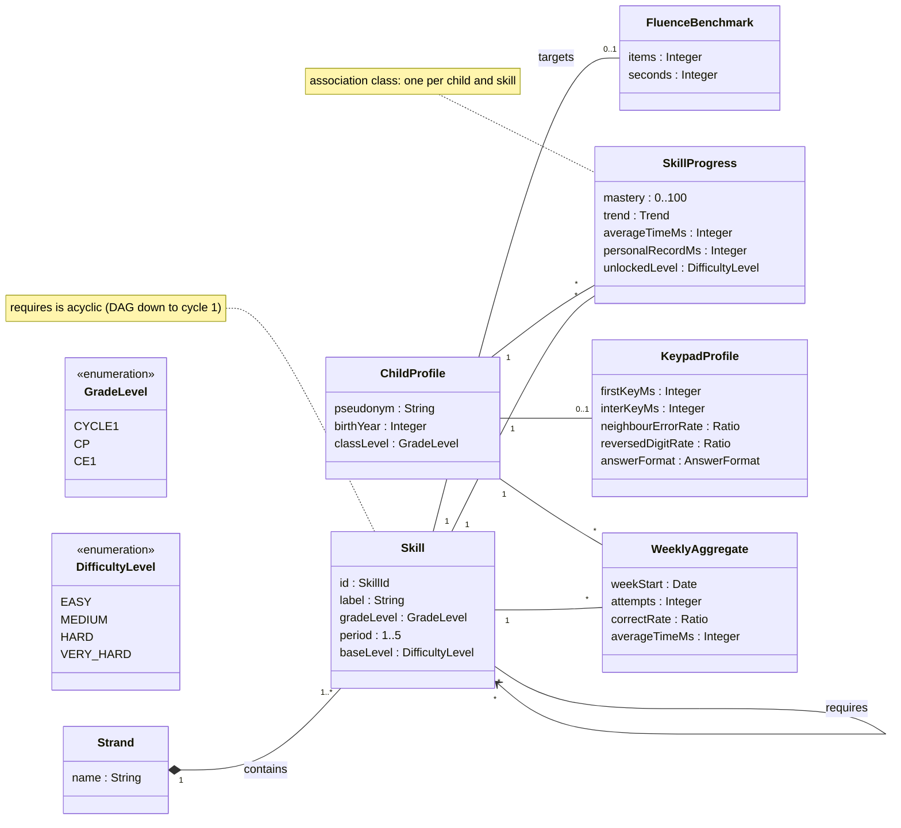
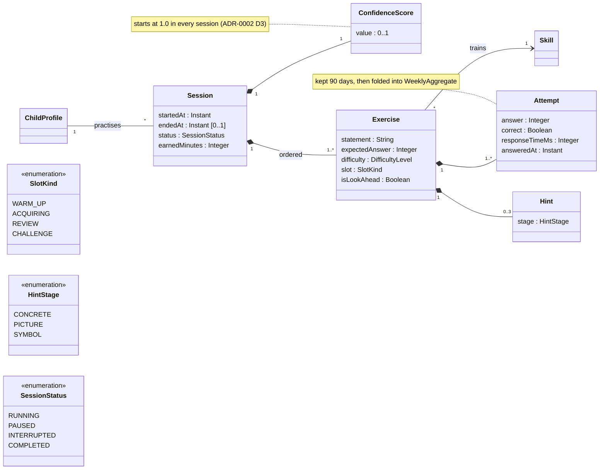
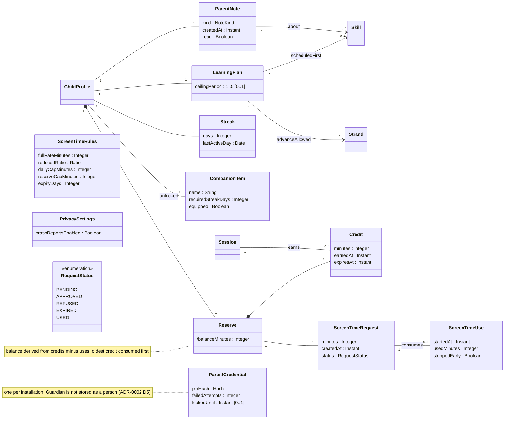

# Class diagram — domain — analysis-level domain model

> **Feature**: whole product, cross-cutting vocabulary
> **Source specs**: `docs/architecture/specs/use-cases.md`, `docs/curriculum/CE1-maths.md`, `docs/CADRAGE.md` §2–4
> **Related ADRs**: ADR-0001, ADR-0002
> **Decisions captured**: M1–M4, C1–C4, R4, T1, T2, Q4, Conversion, P1, P3, V1, V3, V4, E1

## Context

Analysis level: concepts, attributes, associations and multiplicities only. No operations, no interfaces, no persistence or framework types (Clean Architecture: this is the inner domain). Split in three areas (ADR-0002 D6). A class drawn without attributes is a stub whose home is another area.

## Diagram 1 — curriculum and progress

## Diagram 2 — practice

## Diagram 3 — rewards and parent space

## Concept dictionary

| Concept | Meaning | Traces to |
|---|---|---|
| Strand, Skill | Curriculum node and its strand, static data from the programme | C3, C4, curriculum file |
| FluenceBenchmark | Official target (for example 8 multiplication equalities in 60 s) | C2 |
| ChildProfile | Pseudonym, birth year, class level only | V3, UC-P2 |
| SkillProgress | Mastery, trend, personal average time and record, unlocked level of one child on one skill | M1, M2, C4 |
| KeypadProfile | Statistics from calibration and daily use, never a diagnosis | T1, UC-L7 |
| WeeklyAggregate | Folded answers after 90 days | V1 |
| Session, Exercise, Attempt, Hint | One framed session, its ordered exercises, the answers and the hints shown | E3, M3, M4, UC-L1, UC-L2, UC-L4 |
| ConfidenceScore | Anti-cheat score of one session | T2, ADR-0002 D3 |
| Reserve, Credit | Ledger of earned minutes, each credit expiring after 7 days | Q4, ADR-0002 D2 |
| ScreenTimeRequest, ScreenTimeUse | A request and its use, which debits the reserve | P3, UC-S1–S3 |
| ScreenTimeRules | Conversion, daily cap, reserve cap, expiry | Conversion, UC-S5 |
| Streak, CompanionItem | Day streak and unlocked companion items | E1, UC-L9 |
| LearningPlan | Ceiling, strands allowed ahead, skill scheduled by the Guardian | C1, R4, UC-P3, P4, P7 |
| ParentNote | Neutral alerts and notes for the Guardian | M4, T2, UC-P6 |
| ParentCredential | PIN hash and lockout state | P1, UC-P1, P10, P12 |
| PrivacySettings | Crash-report opt-in, off by default | V4, UC-P11 |

## Notes

- No operations on purpose: responsibilities are assigned in the sequence diagrams, then drawn in the design class diagram.
- Composition (filled diamond) means the part dies with the whole: erasing a child (UC-P9) erases its sessions, reserve and notes.
- Derived attribute `/balanceMinutes` is computed, never stored (DRY).
- Thresholds live in configuration, not in these classes.
- Not in the model: the exported file (an adapter artefact), the clock and TTS (adapters), the OS (external).
