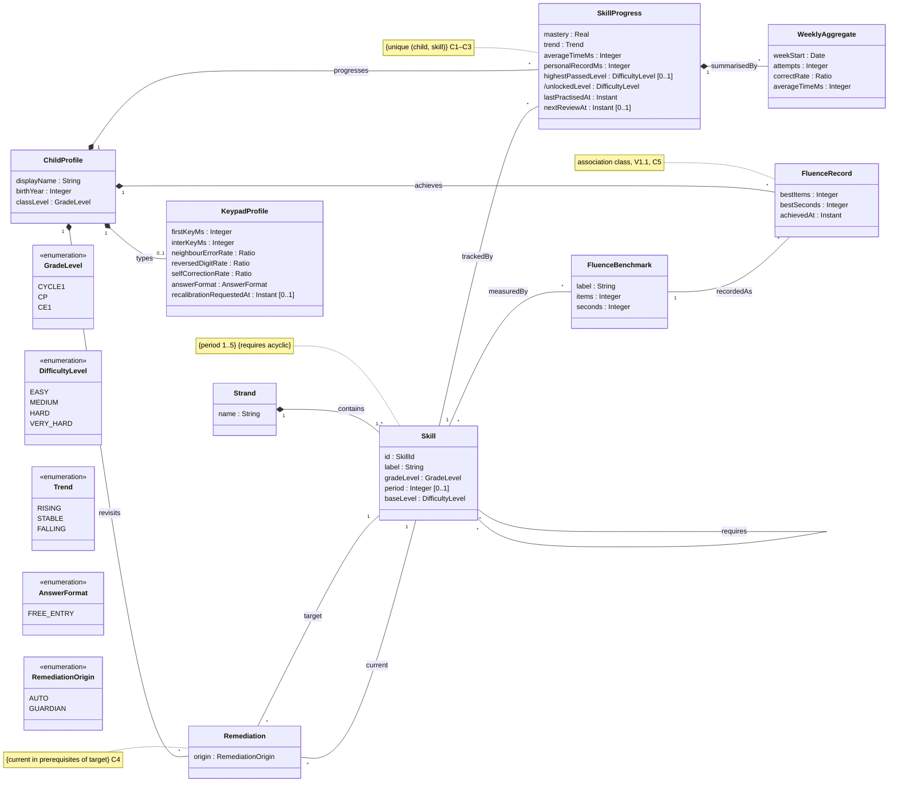
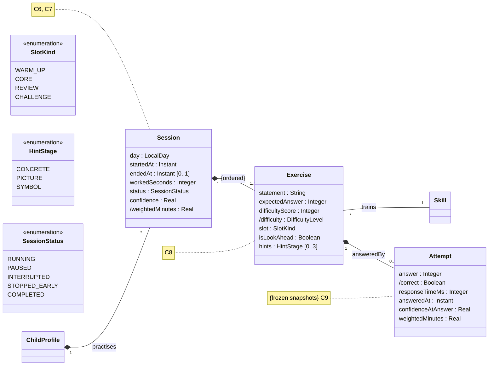
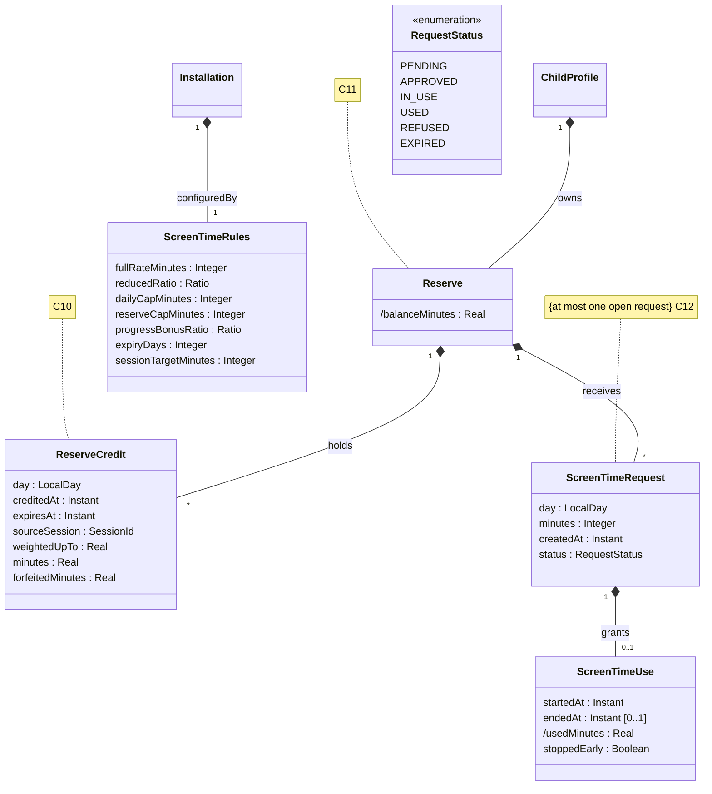
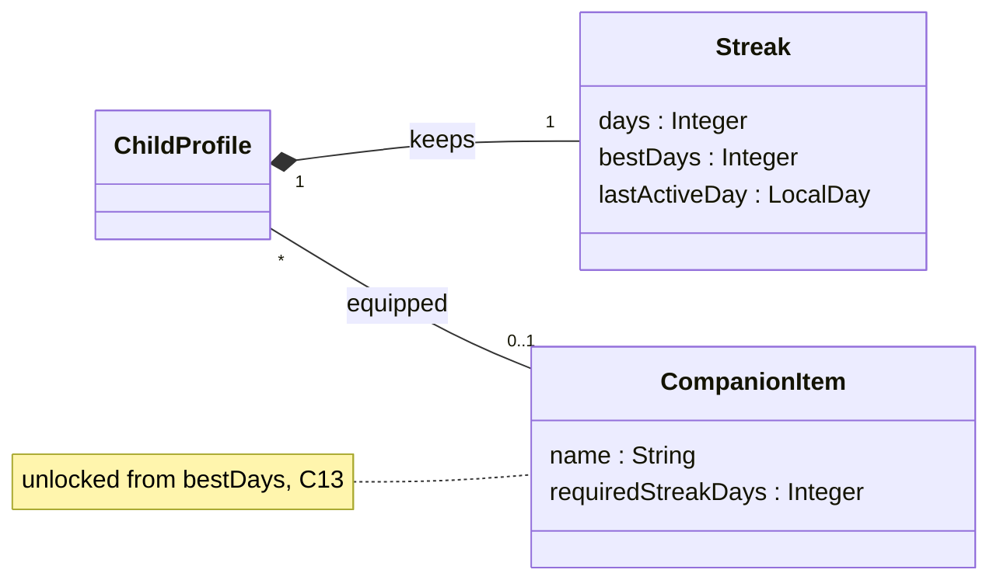
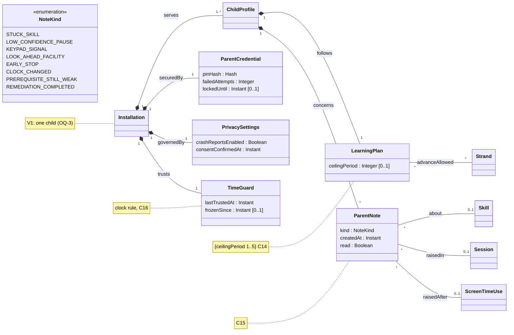

# Class diagram — domain — analysis-level domain model

> **Feature**: whole product, cross-cutting vocabulary
> **Source specs**: `docs/architecture/specs/use-cases.md`, `docs/curriculum/CE1-maths.md`, `docs/CADRAGE.md` §2–4
> **Related ADRs**: ADR-0001, ADR-0002
> **Decisions captured**: CADRAGE Q1, Q4, Conversion, M1–M4, D1, D2, T1, T2, E1, E3, P0–P3, S1, V1, V3, V4, C1–C4, R4; ADR-0002 D1–D8

## Context

Analysis level: concepts, attributes, associations, multiplicities and constraints only. No operations, no interfaces, no persistence or framework types (Clean Architecture: this is the inner domain). Split in four areas (ADR-0002 D6):

- Diagram 1, curriculum and progress: Strand, Skill, FluenceBenchmark, ChildProfile, SkillProgress, FluenceRecord, Remediation, KeypadProfile, WeeklyAggregate.
- Diagram 2, practice: Session, Exercise, Attempt.
- Diagram 3, rewards: Reserve, ReserveCredit, ScreenTimeRequest, ScreenTimeUse, ScreenTimeRules.
- Diagram 3b, companion: Streak, CompanionItem.
- Diagram 4, parent space and installation: Installation, LearningPlan, ParentNote, ParentCredential, PrivacySettings, TimeGuard.

A class drawn without attributes is a stub whose home is another area.

## Diagram 1 — curriculum and progress

## Diagram 2 — practice

## Diagram 3 — rewards

## Diagram 3b — companion

## Diagram 4 — parent space and installation

## Constraints

Referenced from the diagrams by number (Mermaid notes stay short to keep the diagrams readable).

- C1. SkillProgress is a reified association class, one per child and skill. `mastery` is a Real from 0 to 100, rounded only for display.
- C2. A level is passed when the skill mastery reaches 70 % while practising at that level (ADR-0002 D9); `highestPassedLevel` records it at that moment, so the unlock survives the folding of attempts. `/unlockedLevel` is the level after `highestPassedLevel`, capped at VERY_HARD (passing VERY_HARD keeps it unlocked), or `Skill.baseLevel` when none is passed yet.
- C3. `averageTimeMs` counts correct answers only (M2). `trend` and `averageTimeMs` are stored on purpose, because attempts are folded after 90 days.
- C4. Remediation: `current` is a prerequisite, direct or indirect, of `target`. Origin GUARDIAN is the "go back to X" button (UC-P7), AUTO comes from the 3-error rule (UC-L5). Exercises during a remediation practise `current`, so the end rule reads the mastery of `current`: an AUTO remediation closes by itself once that mastery is back at the threshold, and practice returns to `target`. A GUARDIAN remediation closes at the same threshold and raises a REMEDIATION_COMPLETED note, so the Guardian knows the request was met.
- C5. FluenceRecord is the association class child × benchmark. It is measured on a timed window, with no visible countdown.
- C6. `confidence` is a Real from 0 to 1, starts at 1.0 in every session, from V1.1 (ADR-0002 D3). `workedSeconds` accumulates only while RUNNING and feeds crediting. The session ends on `ScreenTimeRules.sessionTargetMinutes` (default 15, from 10 to 20, UC-L1 step 4): elapsed app time since `startedAt`, warm-up and PAUSED time included, so a pause never lengthens the session. `/weightedMinutes` is the sum of the attempts' `weightedMinutes`.
- C7. PAUSED is the confidence pause (UC-L1 4c), INTERRUPTED means the app was closed and the session can resume, STOPPED_EARLY means the child ended it. Each interruption or end credits only what is not yet credited: the checkpoint is the highest `weightedUpTo` among the ReserveCredits whose `sourceSession` is this session (0 if none). The credit and its checkpoint are one write in the Reserve aggregate, so a kill can neither duplicate nor lose it, and `(sourceSession, weightedUpTo)` is unique, so a retry is a no-op. The uncredited attempts are split by the LocalDay of their `answeredAt`, one ReserveCredit per day, so a session crossing midnight applies each day's threshold (D10) and expiry. An interrupted session untouched for a day becomes STOPPED_EARLY.
- C8. `difficultyScore` is the skill base level, scored Easy 0 / Medium 2 / Hard 3 / Very hard 5 (`docs/curriculum/CE1-maths.md`), plus the modifiers (C4 of CADRAGE); the level is mapped from it in configuration. `hints` lists the stages already shown, in order, never repeated. `isLookAhead` is a snapshot taken at generation (skill period above the ceiling).
- C9. `correct` is derived: the answer equals `expectedAnswer`. `confidenceAtAnswer` and `weightedMinutes` are frozen at answer time (ADR-0002 D8, D11): response time × difficulty multiplier × confidence factor for a correct answer, 0 for a wrong one, values in configuration. Attempts are kept 90 days with their session and exercises, then folded into WeeklyAggregate. `AnswerFormat` gets further values with UC-L7 (V1.2).
- C10. A ReserveCredit is recorded at each session end or interruption (C7). `expiresAt` is frozen at creation as the latest `answeredAt` of the credit's attempts + `expiryDays`, so a credit split off a session crossing midnight expires from its own earning day, not from the later crediting time, and each credit expires at its own instant and a later change of `expiryDays` never touches it. `minutes` is cut by `reserveCapMinutes`, the headroom being computed on the unexpired credits' remaining minutes without subtracting an IN_USE hold, so releasing the unused part of a hold can never lift the balance above the cap; the cut part is recorded in `forfeitedMinutes`, not lost silently. Amounts are Real so no earned fraction is lost; only display rounds, down to the whole minute.
- C11. `/balanceMinutes` is replayed (ADR-0002 D2): uses and the open IN_USE request consume the unexpired credits oldest first; what an expired credit still held is lost. At approval and again when the use starts, `request.minutes` must not exceed the balance. From its start, an IN_USE request holds its full `minutes` in the replay, so a credit expiring during the use cannot make the balance negative; at the end only `/usedMinutes` stays consumed: `min(request.minutes, endedAt − startedAt)`, the device time since the stored start, which also holds when the app was suspended, closed or the device restarted (UC-S3 *a); a timer whose end has passed is closed with that debit. If the clock went backwards during the use (C16), `/usedMinutes` is the full `request.minutes`. An early stop is debited exactly. A PENDING or APPROVED request still open at the end of its `day` becomes EXPIRED (UC-S2), so it never blocks the next day's request. Rule changes (UC-S5) apply to new movements only.
- C12. At most one request is PENDING, APPROVED or IN_USE. The day's used minutes plus its open approved minutes never exceed `dailyCapMinutes`. A USED request has exactly one use, and `/usedMinutes` never exceeds `request.minutes`.
- C13. CompanionItem is a static catalogue. An item is unlocked when `Streak.bestDays` reaches `requiredStreakDays`, so a broken streak never locks an item again.
- C14. The skill the Guardian wants first is a Remediation with origin GUARDIAN (C4).
- C15. A note of kind EARLY_STOP has a ScreenTimeUse. Links to a session or a use are cleared when those are folded after 90 days.
- C16. Expiry and day changes use the larger of now and `lastTrustedAt`. A backwards clock change sets `frozenSince`, debits a running screen-time use in full (C11) and raises a CLOCK_CHANGED note.

## Concept dictionary

| Concept | Meaning | Traces to | Version |
|---|---|---|---|
| Installation | Root owning the child profiles and every installation-wide object | OQ-3, UC-P8, P9, P15 | V1.0 |
| Strand, Skill | Curriculum node and its strand, static data from the programme | C3, C4, curriculum file | V1.0 |
| FluenceBenchmark, FluenceRecord | Official milestone over one or more skills and the child's best result against it | C2, UC-L8, UC-P5 | V1.1 |
| ChildProfile | Display name (first name or pseudonym), birth year, class level only | V3, P0, UC-P2 | V1.0 |
| SkillProgress | Mastery, trend, personal average time and record, review schedule of one child on one skill. The unlocked level is derived | M1, M2, M3, C4 | V1.0 (review schedule V1.1) |
| Remediation | A skill the child goes back to, automatic or set by the Guardian | R4, UC-L5, UC-P7 | V1.1 |
| KeypadProfile | Statistics from calibration and daily use, never a diagnosis; time of the re-calibration request | T1, UC-L7, UC-P13 | V1.2 |
| WeeklyAggregate | Folded answers of one child on one skill after 90 days | V1 | V1.0 |
| Session, Exercise, Attempt | One framed session, its ordered exercises (with the hints shown) and the answers | E3, M3, M4, D1, D2, UC-L1, UC-L2, UC-L4 | V1.0 (confidence, REVIEW and CHALLENGE slots, look-ahead V1.1) |
| Reserve, ReserveCredit | Screen-time minutes earned, each credit expiring after `expiryDays` (default 7), balance replayed oldest first | Q4, P3, ADR-0002 D2 | V1.0 |
| ScreenTimeRequest, ScreenTimeUse | A request the Guardian approves or refuses, and its use | P3, UC-S1, UC-S2 | V1.0 |
| ScreenTimeRules | Conversion, daily cap, reserve cap, expiry, session duration | Conversion, UC-S5 | V1.0 defaults, editing V1.1 |
| Streak, CompanionItem | Day streak and the companion catalogue it unlocks | E1, UC-L9 | V1.2 |
| LearningPlan | Ceiling and strands allowed ahead | C1, UC-P3, UC-P4 | V1.1 |
| ParentNote | Neutral alerts and notes for the Guardian | M4, T1, T2, C1, UC-P6 | V1.1 |
| ParentCredential | PIN hash and lockout state | P1, UC-P1, UC-P10, UC-P12 | V1.0 |
| PrivacySettings | Parental consent date, crash-report opt-in off by default | V4, §4 consent, UC-P11, UC-P14 | V1.0 (crash opt-in V1.1) |
| TimeGuard | Last trusted instant, protects expiry and daily rules against clock changes | clock rule (use cases cross-cutting) | V1.0 |

## Aggregates

Each aggregate is loaded and saved as one unit. Aggregates refer to each other by identifier, never by loaded object (Clean Architecture: this is what the storage port will persist).

| Aggregate | Root and parts | Consistency rule kept together |
|---|---|---|
| Practice | Session, its Exercises and Attempts | one answer updates the attempt, the session confidence and the worked time |
| Progress | SkillProgress and its WeeklyAggregates, Remediation, FluenceRecord | mastery, trend and unlocked level of a skill |
| Reserve | Reserve, its credits, requests and uses | balance, daily cap, one open request |
| Child | ChildProfile identity, Streak, KeypadProfile | identity, streak and keypad statistics |
| LearningPlan | LearningPlan | ceiling and strands, changed by the Guardian only |
| ParentNote | one ParentNote | each note is written on its own by the engine and read by the Guardian |
| Installation | Installation, ParentCredential, PrivacySettings, ScreenTimeRules, TimeGuard | PIN lockout, clock trust, rules |

Between aggregates the consistency is eventual: closing a session credits the reserve afterwards, a stopped-early use may raise a note afterwards. Erasing a child (UC-P9) cascades over every aggregate that carries its identifier.

## Notes

- No operations on purpose: responsibilities are assigned in the sequence diagrams, then drawn in the design class diagram.
- Composition (filled diamond) means the part dies with the whole. Skill, Strand and CompanionItem are static data and survive an erase.
- No generalization in the model (ADR-0002 D7): credits and uses are both reserve movements, but they share no rule (a credit expires and is capped, a use is bounded by its request), so no common superclass.
- Derived attributes (`/`) are computed, never stored (DRY). Frozen snapshots taken at event time (confidence at answer, weighted minutes, isLookAhead) are stored on purpose, because their inputs change afterwards.
- Currency (ADR-0002 D8, D11): one quantity feeds the reserve, the weighted minutes. Per correct attempt: response time x difficulty multiplier x confidence factor; a wrong attempt earns 0. At session end, each skill whose mastery rose during the session adds `progressBonusRatio` x the weighted minutes earned on it. At each session end or interruption, the day's weighted minutes are converted at the full rate up to `fullRateMinutes` per day, then at `reducedRatio` (OQ-4, decided per day), and recorded as a ReserveCredit of that day within the reserve cap.
- Day: `LocalDay` is the local calendar day computed from the trusted time (TimeGuard). It is used by the daily cap, credit expiry, the streak and the conversion threshold.
- Value types: `SkillId`, `SessionId` (reference by identifier between aggregates), `Ratio` (0 to 1), `Hash`, `Instant`, `Date`, `LocalDay` are primitive value types, not entities. `SkillId` is the stable dotted `<grade>.<name>` of the curriculum graph (`cp.add10`, `ce1.table2`).
- `GradeLevel.CYCLE1` names a cycle, not a class level; a child profile only uses CP or CE1.
- Navigability is left out at analysis level; it is decided in the design class diagram. `{ordered}` and `{unique}` are drawn as association labels because Mermaid cannot place a constraint at an association end.
- Thresholds and multipliers live in configuration, not in these classes.
- Not in the model: the exported file (an adapter artefact), the clock, TTS and the timer-end alarm scheduled with the OS (adapters), the OS (external), and encryption at rest (a storage adapter concern, ADR-0003).
- Known limits, accepted (YAGNI): `answer` is an integer (fractions come later); a Strand has no subject until reading arrives in V2.
- Open question OQ-5: does UC-P9 (erase) also remove the PIN, the consent and the rules, or only the child's data? And a restore (UC-P15) of an old export would bring back minutes already spent: the sequence study must decide the guard (refuse an export older than the current data, or replay the balance against TimeGuard).
