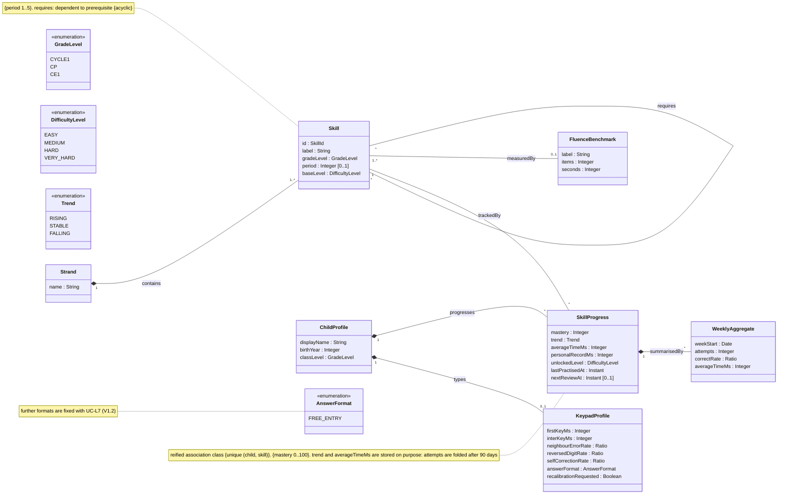
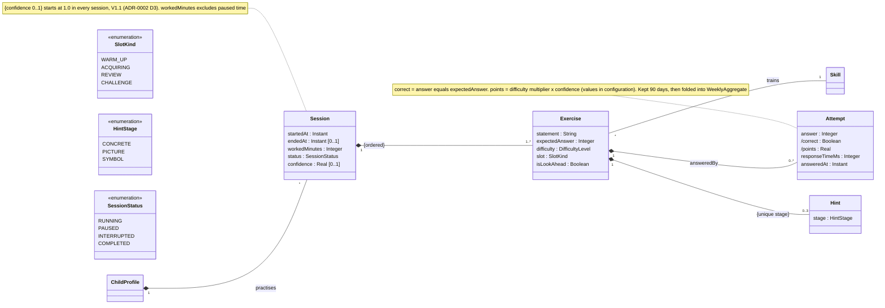
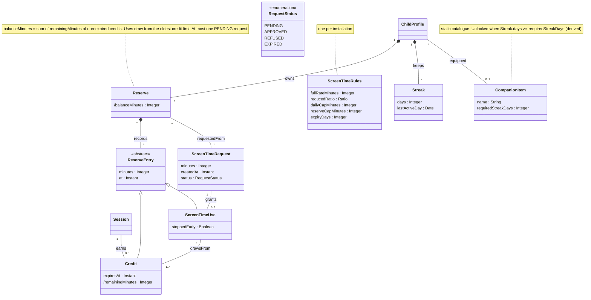
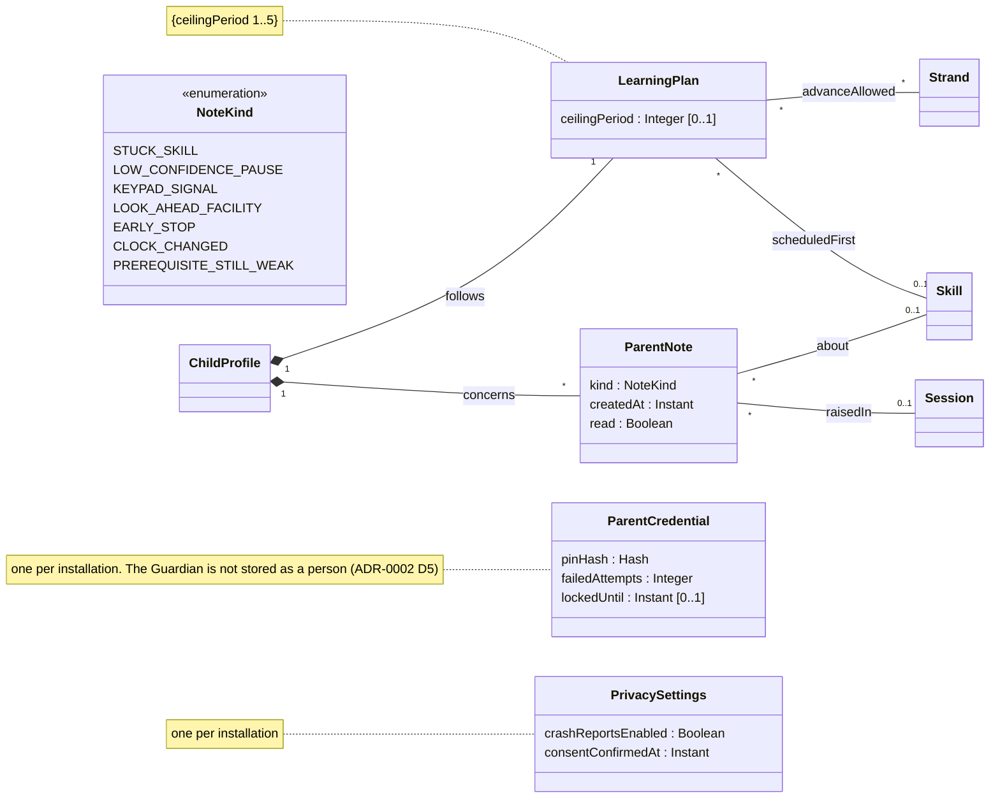

# Class diagram — domain — analysis-level domain model

> **Feature**: whole product, cross-cutting vocabulary
> **Source specs**: `docs/architecture/specs/use-cases.md`, `docs/curriculum/CE1-maths.md`, `docs/CADRAGE.md` §2–4
> **Related ADRs**: ADR-0001, ADR-0002
> **Decisions captured**: Q1, Q4, Conversion, M1–M4, D1, D2, T1, T2, E1, E3, P0–P3, S1, V1, V3, V4, C1–C4, R4

## Context

Analysis level: concepts, attributes, associations, multiplicities and constraints only. No operations, no interfaces, no persistence or framework types (Clean Architecture: this is the inner domain). Split in four areas (ADR-0002 D6):

- Diagram 1, curriculum and progress: home of Strand, Skill, FluenceBenchmark, ChildProfile, SkillProgress, KeypadProfile, WeeklyAggregate.
- Diagram 2, practice: home of Session, Exercise, Attempt, Hint.
- Diagram 3, rewards: home of Reserve and its entries, ScreenTimeRequest, ScreenTimeRules, Streak, CompanionItem.
- Diagram 4, parent space: home of LearningPlan, ParentNote, ParentCredential, PrivacySettings.

A class drawn without attributes is a stub whose home is another area.

## Diagram 1 — curriculum and progress

## Diagram 2 — practice

## Diagram 3 — rewards

## Diagram 4 — parent space

## Concept dictionary

| Concept | Meaning | Traces to | Version |
|---|---|---|---|
| Strand, Skill | Curriculum node and its strand, static data from the programme | C3, C4, curriculum file | V1.0 |
| FluenceBenchmark | Official milestone over one or more skills (for example 8 multiplication equalities in 60 s) | C2 | V1.1 |
| ChildProfile | Display name (first name or pseudonym), birth year, class level only | V3, P0, UC-P2 | V1.0 |
| SkillProgress | Mastery, trend, personal average time and record, unlocked level and review schedule of one child on one skill | M1, M2, M3, C4 | V1.0 (review schedule, unlocked level V1.1) |
| KeypadProfile | Statistics from calibration and daily use, never a diagnosis; re-calibration flag | T1, UC-L7, UC-P13 | V1.2 |
| WeeklyAggregate | Folded answers of one child on one skill after 90 days | V1 | V1.0 |
| Session, Exercise, Attempt, Hint | One framed session, its ordered exercises, the answers and the hints shown | E3, M3, M4, D1, D2, UC-L1, UC-L2, UC-L4 | V1.0 (confidence, REVIEW and CHALLENGE slots, look-ahead V1.1) |
| Reserve, ReserveEntry, Credit, ScreenTimeUse | Ledger of minutes: credits earned, each expiring after `expiryDays` (default 7), and uses drawing from them | Q4, P3, ADR-0002 D2, D7 | V1.0 |
| ScreenTimeRequest | A request the Guardian approves or refuses | P3, UC-S1, UC-S2 | V1.0 |
| ScreenTimeRules | Conversion, daily cap, reserve cap, expiry | Conversion, UC-S5 | V1.0 defaults, editing V1.1 |
| Streak, CompanionItem | Day streak and the companion catalogue it unlocks | E1, UC-L9 | V1.2 |
| LearningPlan | Ceiling, strands allowed ahead, skill scheduled by the Guardian | C1, R4, UC-P3, UC-P4, UC-P7 | V1.1 |
| ParentNote | Neutral alerts and notes for the Guardian | M4, T1, T2, C1, UC-P6 | V1.1 |
| ParentCredential | PIN hash and lockout state | P1, UC-P1, UC-P10, UC-P12 | V1.0 |
| PrivacySettings | Parental consent date, crash-report opt-in off by default | V4, §4 consent, UC-P11, UC-P14 | V1.0 (crash opt-in V1.1) |

## Notes

- No operations on purpose: responsibilities are assigned in the sequence diagrams, then drawn in the design class diagram.
- Composition (filled diamond) means the part dies with the whole: erasing a child (UC-P9) erases every part composed under ChildProfile. Skill, Strand and CompanionItem are static data and survive.
- Generalization: Credit and ScreenTimeUse are both movements of the reserve (ADR-0002 D7).
- Derived attributes (`/`) are computed, never stored (DRY).
- Value types: `SkillId`, `Ratio` (0 to 1), `Hash`, `Instant`, `Date` are primitive value types, not entities.
- `GradeLevel.CYCLE1` names a cycle, not a class level; a child profile only uses CP or CE1.
- Navigability is left out at analysis level; it is decided in the design class diagram.
- Thresholds and multipliers live in configuration, not in these classes.
- Not in the model: the exported file (an adapter artefact), the clock and TTS (adapters), the OS (external).
- Known limits, accepted (YAGNI): `answer` is an integer (fractions come later); a Strand has no subject until reading arrives in V2.
- Open question OQ-4: does the conversion threshold "20 min of work" count per session or per day? CADRAGE does not say; owner to decide before the sequences.
