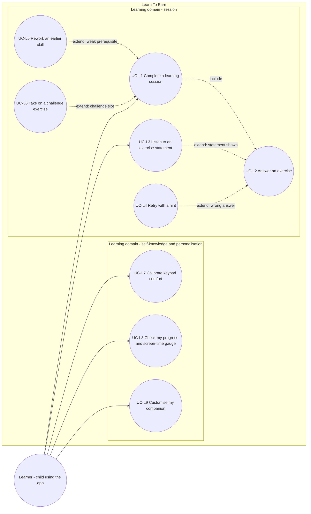

# Use case diagram — learning — sessions, exercises, self-knowledge

> **Feature**: learning domain of Learn To Earn (child side)
> **Source specs**: `docs/architecture/specs/use-cases.md` (UC-L1 to UC-L9)
> **Related ADRs**: ADR-0001
> **Decisions captured**: M1–M4, C1, C4, R4, T1, E1–E4

## Context

Shows what the Learner wants to achieve in the learning domain. It does not show screen time (see `screen-time`) nor the parent space. Structure (mobile, engine, storage) is left to the component diagram.

## Diagram

## Notes

- Dashed arrows are UML include and extend relationships. The arrow of an extend points from the extension to the base use case.
- UC-L4, UC-L5 and UC-L6 have no direct actor link: they are conditional segments of a goal the Learner already started (ADR-0001 D2).
- System events (3-error alert, confidence pause, level drop) are not use cases (ADR-0001 D4). They appear as extensions in the textual spec.
- UC-L7 and UC-L9 ship in V1.2, UC-L5 and UC-L6 in V1.1, the others in V1.0.
- Open point for review: the primary actor of UC-L5 is the Learner although the engine selects the skill.
