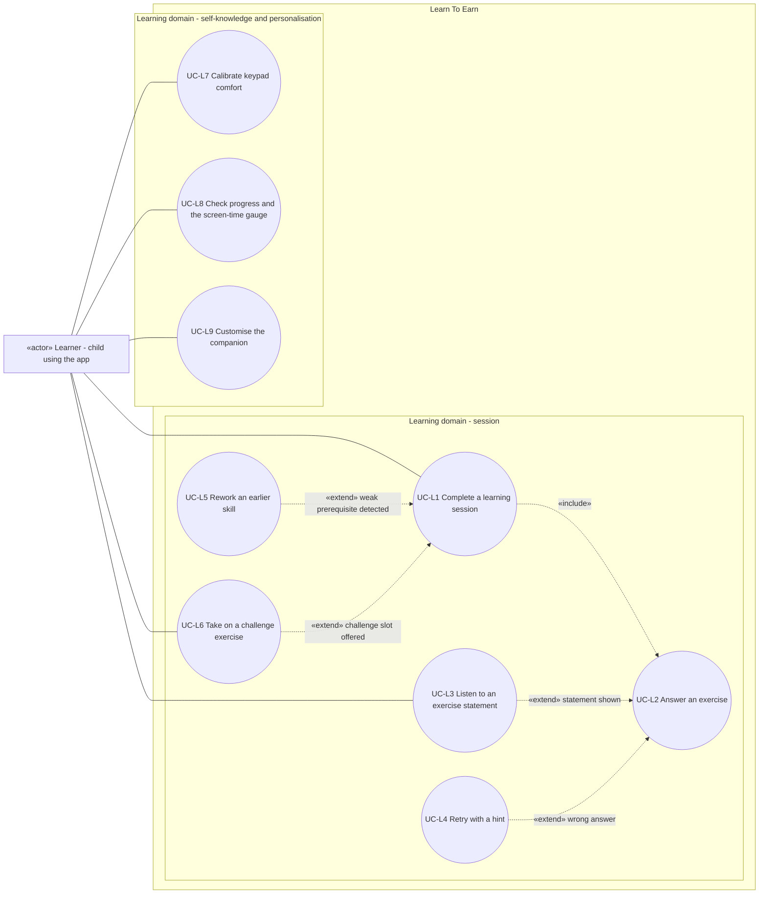

# Use case diagram — learning — sessions, exercises, self-knowledge

> **Feature**: learning domain of Learn To Earn (child side)
> **Source specs**: `docs/architecture/specs/use-cases.md` (UC-L1 to UC-L9)
> **Related ADRs**: ADR-0001
> **Decisions captured**: M1–M4, C1, C3, C4, R4, T1, E1–E4

## Context

Shows what the Learner wants to achieve in the learning domain. It does not show screen time (see `screen-time`) nor the parent space. Structure (mobile, engine, storage) belongs to the component diagram.

## Diagram

## Notes

- Mermaid has no native use-case notation: actors are rectangles tagged «actor», use cases are circles, the System box is a subgraph. Dashed arrows are UML include and extend. An extend arrow points from the extension to the base use case. Associations are undirected.
- Extension points are declared on the base use cases in the spec: UC-L1 (`weak prerequisite detected`, `challenge slot offered`), UC-L2 (`statement shown`, `wrong answer`).
- Actor links follow ADR-0001 D2: an extension is linked to an actor only if the actor can start it on their own (UC-L3 tap, UC-L6 acceptance). UC-L4 and UC-L5 are conditional segments with the actor inherited from the base.
- System events (3-error alert, confidence pause, level drop) are not use cases (ADR-0001 D4).
- Versions: UC-L3, UC-L7, UC-L9 in V1.2, UC-L5 and UC-L6 in V1.1, the others in V1.0.
