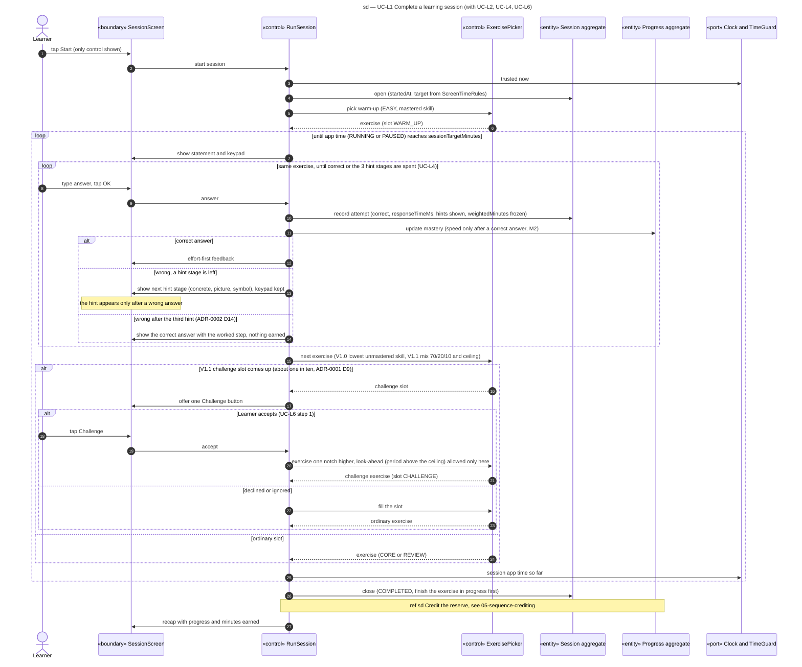

# Sequence diagram — learning — session with adaptive choice

> **Feature**: learning domain, UC-L1 with UC-L2 and UC-L6
> **Source specs**: `docs/architecture/specs/use-cases.md` (UC-L1, UC-L2, UC-L4, UC-L6)
> **Related ADRs**: ADR-0001 (D9, D11), ADR-0002 (D8, D11, D14, D15), ADR-0004 (D1, D4, D10, D11)
> **Decisions captured**: E3, M1–M4, C1, C3, C4, Conversion

## Context

Analysis-level sequence (ICONIX robustness style): «boundary» screens, «control» use-case handlers, «entity» aggregates of the domain model, and ports for time and storage. It assigns responsibilities that the design class diagram will turn into operations. Confidence scoring is in [03-sequence-confidence-scoring.md](03-sequence-confidence-scoring.md), remediation in [04-sequence-remediation.md](04-sequence-remediation.md), crediting in [05-sequence-crediting.md](05-sequence-crediting.md). Each aggregate change is saved through the storage port, one write per aggregate (not drawn).

Progressive disclosure: the child screen first shows only "Start". During an exercise only the statement, the keypad and "OK" are shown; the hint appears only after a wrong answer, the challenge button only at a challenge slot, the recap only at the end.

## Diagram

## Notes

- A stop (UC-L1 *a) or an interruption (UC-L1 *b) closes the Session as STOPPED_EARLY or INTERRUPTED and runs the same crediting reference.
- On a launch the same LocalDay an INTERRUPTED session shows two buttons only: resume or see the partial recap. Time while the app is closed does not count, and after the end of its LocalDay the session is closed STOPPED_EARLY and credited (ADR-0004 D10).
- Weighted minutes of a correct answer use the standard time of its level, never the real response time (ADR-0004 D1); in V1.0 multiplier and confidence factor are 1 and the picker takes the lowest unmastered skill whose prerequisites are all at 70 % or more (D4).
- *(V1.1)* A skill the Guardian scheduled (UC-P7) opens the session with a 5-exercise block right after the warm-up, see 04-sequence-remediation (ADR-0004 D11).
- A correct answer after hints earns a decreasing fraction of its weighted minutes (ADR-0002 D15, factors in configuration, 0 after the third hint).
- The ExercisePicker owns the 70/20/10 mix. The 10 % challenge share exists only as offered slots (ADR-0001 D9), so the child chooses only within it (UC-L6 rule).
- Storage is a port: the domain never sees SQLCipher or Expo types (ADR-0003, Clean Architecture).
