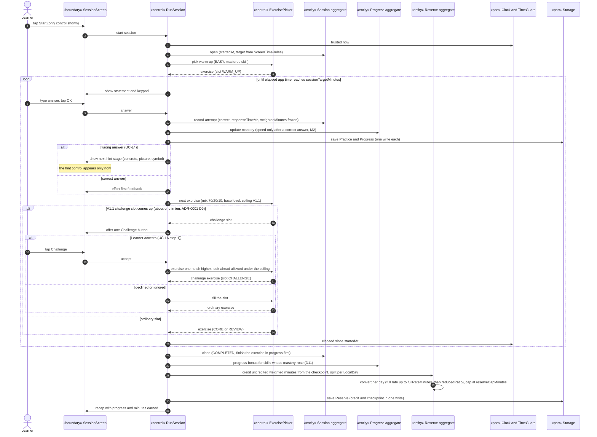

# Sequence diagram — learning — session with adaptive choice and crediting

> **Feature**: learning domain, UC-L1 with UC-L2 and UC-L6
> **Source specs**: `docs/architecture/specs/use-cases.md` (UC-L1, UC-L2, UC-L4, UC-L6)
> **Related ADRs**: ADR-0001 (D9, D11), ADR-0002 (D2, D8, D10, D11)
> **Decisions captured**: E3, M1–M4, C1, C3, C4, Conversion

## Context

Analysis-level sequence (ICONIX robustness style): «boundary» screens, «control» use-case handlers, «entity» aggregates of the domain model, and ports for time and storage. It assigns responsibilities that the design class diagram will turn into operations. Confidence scoring is in [03-sequence-confidence-scoring.md](03-sequence-confidence-scoring.md), remediation in [04-sequence-remediation.md](04-sequence-remediation.md).

Progressive disclosure: the child screen first shows only "Start". During an exercise only the statement, the keypad and "OK" are shown; the hint appears only after a wrong answer, the challenge button only at a challenge slot, the recap only at the end.

## Diagram

## Notes

- Crediting is idempotent (domain C7): the checkpoint is the highest `weightedUpTo` of this session's credits, so a retry after a kill writes nothing twice. An interruption (UC-L1 *b) credits the attempts only, with the status INTERRUPTED. The progress bonus is credited once, at the final close only (COMPLETED, or STOPPED_EARLY for UC-L1 *a), so killing the app never multiplies it.
- On the next launch an INTERRUPTED session shows two buttons only: resume or see the partial recap.
- The 20-minute full-rate threshold is per day across sessions, so splitting work never changes the minutes earned.
- The ExercisePicker owns the 70/20/10 mix. The 10 % challenge share exists only as offered slots (ADR-0001 D9), so the child chooses only within it (UC-L6 rule).
- Storage is a port: the domain never sees SQLCipher or Expo types (ADR-0003, Clean Architecture).
