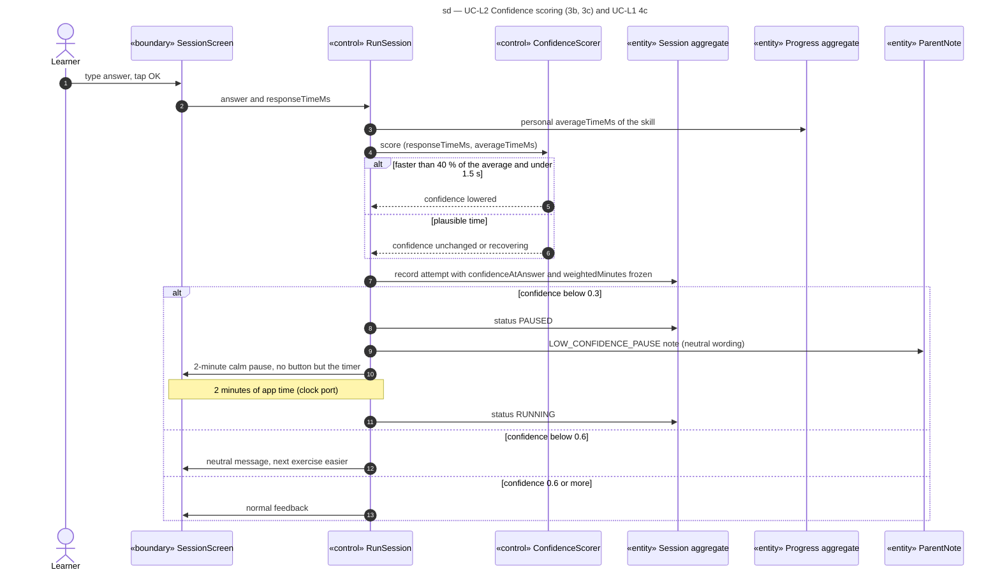

# Sequence diagram — learning — confidence scoring

> **Feature**: learning domain, UC-L2 extensions 3b and 3c, UC-L1 extension 4c (V1.1)
> **Source specs**: `docs/architecture/specs/use-cases.md` (UC-L1, UC-L2)
> **Related ADRs**: ADR-0002 (D3, D8)
> **Decisions captured**: T2, M2

## Context

Detail of the "record attempt" step of [02-sequence-learning-session.md](02-sequence-learning-session.md) once confidence exists (V1.1). Confidence starts at 1.0 in every session and is never shown to the child as an accusation.

Progressive disclosure: the neutral message appears only when confidence is below 0.6, the pause screen only below 0.3. Nothing about confidence is shown otherwise.

## Diagram

## Notes

- Points of a correct answer are multiplied by the confidence factor; a wrong answer earns 0 (ADR-0002 D11).
- PAUSED time counts in the session length, so a pause never lengthens the session (domain C6), and `workedSeconds` does not grow during it.
- The note is for the Guardian (UC-P6); the child never sees a word about speed or cheating.
