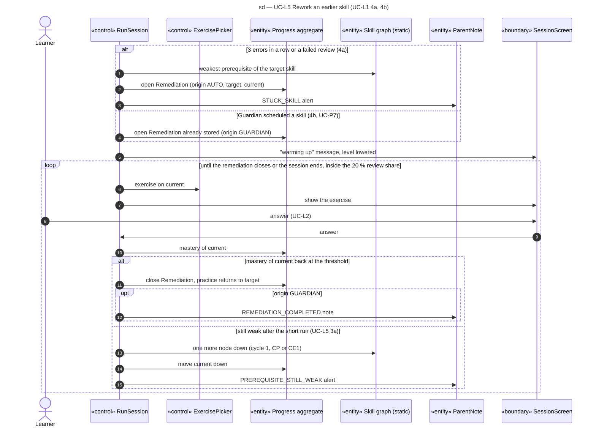

# Sequence diagram — learning — remediation walk-back

> **Feature**: learning domain, UC-L1 extensions 4a and 4b, UC-L5, UC-P7 (V1.1)
> **Source specs**: `docs/architecture/specs/use-cases.md` (UC-L1, UC-L4, UC-L5, UC-P7)
> **Related ADRs**: ADR-0002 (D9)
> **Decisions captured**: R4, M4, C3

## Context

How the session walks down the prerequisite graph when a prerequisite is weak, or when the Guardian scheduled a skill (UC-P7), and how it comes back. Domain constraint C4: exercises practise `current`, and the remediation closes when the mastery of `current` is back at the threshold.

Progressive disclosure: the child sees only "warming up" and the usual exercise screen; the Guardian alert is shown in UC-P6, never on the child screen.

## Diagram

## Notes

- The walk-back never leaves the 20 % review share, so the session mix is unchanged.
- An open Remediation survives the end of the session and continues in the next one.
- The graph is static data (curriculum), read only.
