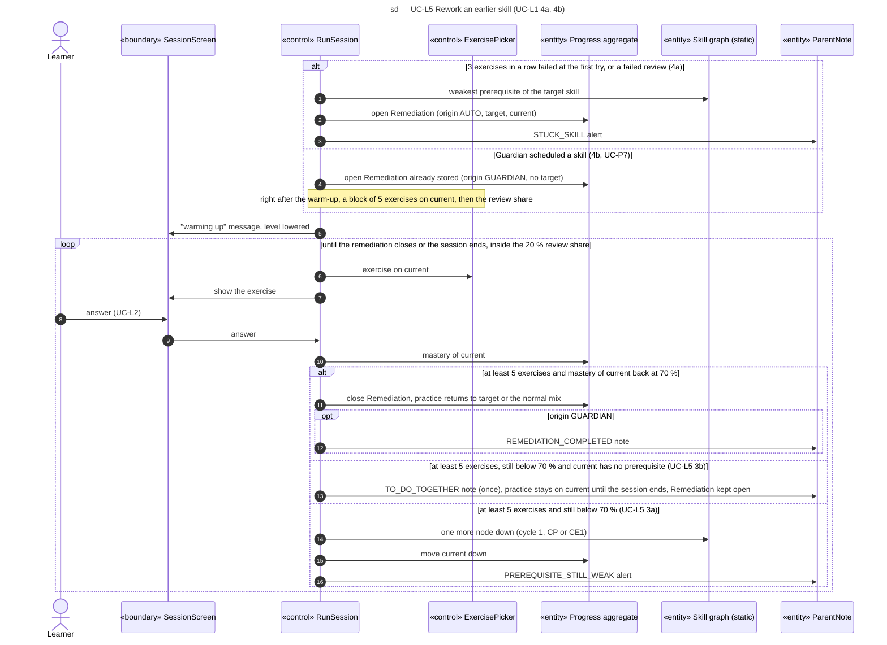

# Sequence diagram — learning — remediation walk-back

> **Feature**: learning domain, UC-L1 extensions 4a and 4b, UC-L5, UC-P7 (V1.1)
> **Source specs**: `docs/architecture/specs/use-cases.md` (UC-L1, UC-L4, UC-L5, UC-P7)
> **Related ADRs**: ADR-0002 (D9), ADR-0004 (D3, D11, D12)
> **Decisions captured**: R4, M4, C3

## Context

How the session walks down the prerequisite graph when a prerequisite is weak, or when the Guardian scheduled a skill (UC-P7), and how it comes back. Domain constraint C4: exercises practise `current`, and the remediation closes when the mastery of `current` is back at the threshold.

Progressive disclosure: the child sees only "warming up" and the usual exercise screen; the Guardian alert is shown in UC-P6, never on the child screen.

## Diagram

## Notes

- `exercisesDone` resets to 0 at each step-down, so every node gets at least 5 exercises. The step-down and the TO_DO_TOGETHER branches fire only after at least 5 exercises (exercisesDone >= 5) still below 70 %; the TO_DO_TOGETHER note is raised once per remediation.
- The walk-back never leaves the 20 % review share, so the session mix is unchanged, except the 5-exercise opening block of a Guardian request (ADR-0004 D11).
- The 3-error rule counts exercises, not tries: the hint loop of one exercise is one error (ADR-0004 D3).
- At the graph floor (UC-L5 3b) the loop ends only with the session; the Remediation stays open for the Guardian (UC-P6), so the walk-back never goes below the floor.
- An open Remediation survives the end of the session and continues in the next one.
- The graph is static data (curriculum), read only.
