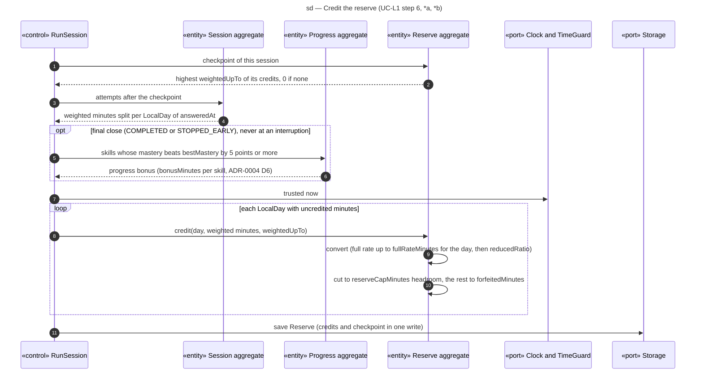

# Sequence diagram — learning — credit the reserve

> **Feature**: learning domain, crediting step of UC-L1 (main scenario step 6, extensions *a and *b)
> **Source specs**: `docs/architecture/specs/use-cases.md` (UC-L1 business rule)
> **Related ADRs**: ADR-0002 (D2, D8, D10, D11), ADR-0004 (D1, D6, D10)
> **Decisions captured**: Conversion, Q4

## Context

Referenced from [02-sequence-learning-session.md](02-sequence-learning-session.md) at every session close or interruption. Domain constraints C7 and C10 hold the rules. No UI: the recap is shown by the caller.

## Diagram

## Notes

- Idempotent (C7): `(sourceSession, weightedUpTo)` is unique, so a retry after a kill writes nothing twice. The bonus is its own credit at the final close, so killing the app never multiplies it.
- The full-rate threshold counts the whole day across sessions, so splitting work never changes the minutes earned.
- `expiresAt` is frozen per credit from its own earning day (C10).
