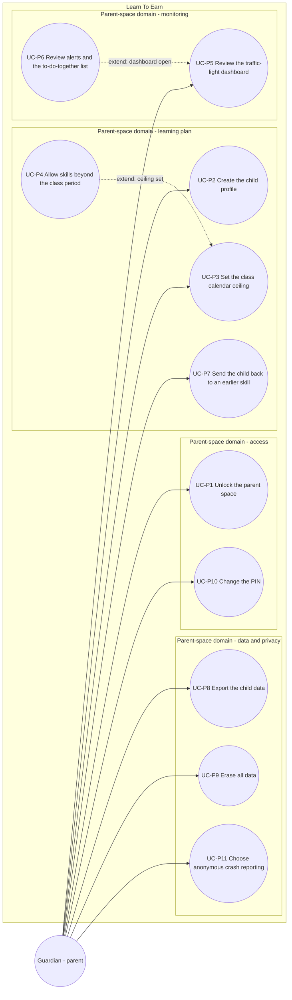

# Use case diagram — parent-space — set-up, monitoring and data control

> **Feature**: parent-space domain of Learn To Earn (Guardian side)
> **Source specs**: `docs/architecture/specs/use-cases.md` (UC-P1 to UC-P11)
> **Related ADRs**: ADR-0001
> **Decisions captured**: P1, P2, C1, C2, R4, S1, V1, V3, V4

## Context

Everything the Guardian does inside the PIN-protected parent space. Approving a request and the screen-time rules are in the `screen-time` diagram. Every use case here has the precondition "parent space unlocked" (UC-P1).

## Diagram

## Notes

- UC-P4 and UC-P6 are extensions with no direct actor link, for the same reason as in the learning diagram.
- UC-P9 (erase) and UC-P8 (export) are legal baselines (privacy by design), not optional features.
- Open point: PIN recovery without letting the child reset it (OQ-1).
- UC-P3, UC-P4, UC-P6, UC-P7 and UC-P11 ship in V1.1, the others in V1.0.
