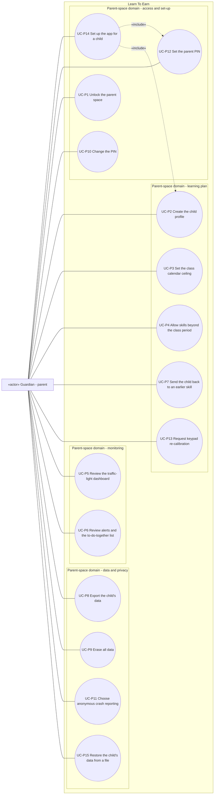

# Use case diagram — parent-space — set-up, monitoring and data control

> **Feature**: parent-space domain of Learn To Earn (Guardian side)
> **Source specs**: `docs/architecture/specs/use-cases.md` (UC-P1 to UC-P15)
> **Related ADRs**: ADR-0001
> **Decisions captured**: P0, P1, P2, C1, C2, M4, R4, S1, T1, V1, V3, V4

## Context

Everything the Guardian does inside the PIN-protected parent space. Approving a request and the screen-time rules are in the `screen-time` diagram. Every use case here except UC-P1, UC-P12 and UC-P14 has the precondition "parent space unlocked" (UC-P1).

## Diagram

## Notes

- The only relationships are UC-P14 «include» UC-P12 and UC-P2 (first-launch set-up always performs both). Shared access is expressed as the precondition "parent space unlocked" (ADR-0001 D2). UC-P4 and UC-P6 were extensions in a first draft and became standalone goals after review pass 1 (extension points were navigation or states, not points of a scenario).
- UC-P13 and UC-L7 (learning domain) are linked by data, not by a UML relationship.
- UC-P8 (export) and UC-P9 (erase) are legal baselines (privacy by design), not optional features.
- Open point: PIN recovery without letting the child reset it (OQ-1).
- Versions: UC-P3, UC-P4, UC-P6, UC-P7, UC-P11 in V1.1, UC-P13 in V1.2, the others in V1.0 (UC-P14 and UC-P15 included).
