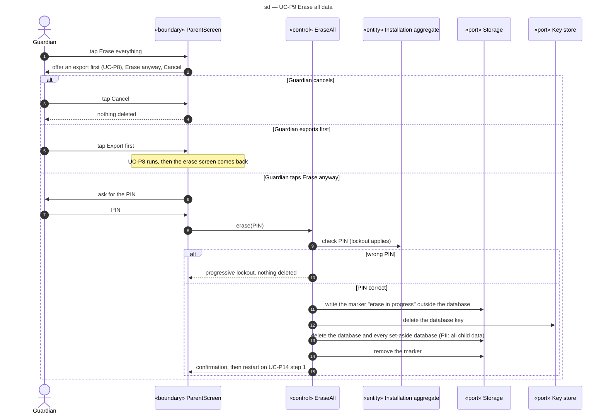

# Sequence diagram — parent-space — erase all data

> **Feature**: parent-space domain, UC-P9 (with UC-P8 offered first)
> **Source specs**: `docs/architecture/specs/use-cases.md` (UC-P8, UC-P9, UC-P14)
> **Related ADRs**: ADR-0002 (D12), ADR-0003
> **Decisions captured**: S1, V1, §4 privacy baseline

## Context

OQ-5 part 1 is decided by ADR-0002 D12: the erase removes everything the app stored, then the app restarts on the set-up.

Progressive disclosure: the screen first shows one "Erase everything" button. The export offer and "Cancel" appear after it, and the PIN confirmation only after "Erase anyway".

## Diagram

## Notes

- Static data (skills, strands, companion catalogue) ships with the app and is not stored data, so nothing remains.
- The key goes first, so any file left behind by a crash is already unreadable. The marker makes the erase resumable: a start-up that finds it finishes the deletion before showing UC-P14.
- Export files the Guardian already saved outside the app (UC-P8) are not erased: the confirmation says so.
- After the restart, the Guardian confirms consent again for the child (UC-P14 step 1).
