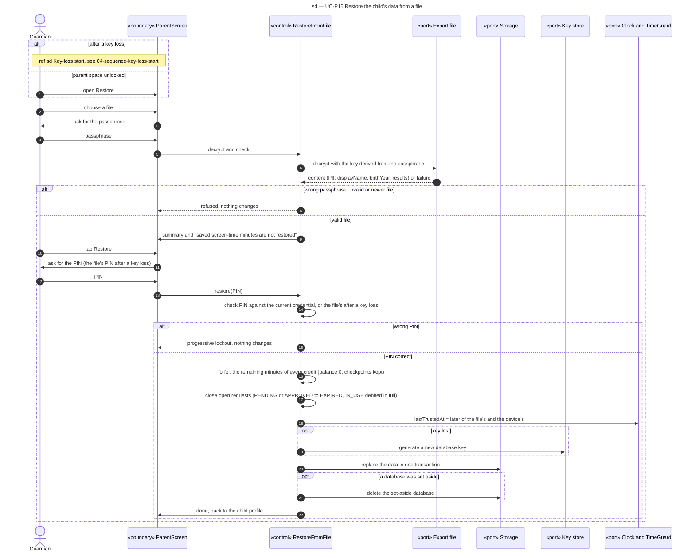

# Sequence diagram — parent-space — restore from a file

> **Feature**: parent-space domain, UC-P15, including the key-loss start screen
> **Source specs**: `docs/architecture/specs/use-cases.md` (UC-P14, UC-P15, storage rule)
> **Related ADRs**: ADR-0002 (D13), ADR-0003 (D3)
> **Decisions captured**: S1

## Context

OQ-5 part 2 is decided by ADR-0002 D13: a restore brings back everything except the screen-time reserve, so no minute already spent can come back.

Progressive disclosure: after a key loss the start screen shows only "Restore from a file" and "Set up again". The passphrase field appears once a file is chosen, the content summary once it decrypts, the PIN only after "Restore".

The key-loss start screen is in [04-sequence-key-loss-start.md](04-sequence-key-loss-start.md).

## Diagram

## Notes

- Forfeiting the reserve closes the replay hole for every case, key loss included (ADR-0002 D13). Credits stay as history, so the crediting checkpoints (domain C7) and the day's full-rate and cap counters are unchanged and an interrupted session in the file is never credited twice. The cost is at most the reserve cap in a rare case.
- While unlocked, the current credential (PIN hash, recovery code hash, lockout) is kept; the file's credential applies only after a key loss, and then the lockout counter starts from it. The passphrase is the stronger gate.
- The set-aside database is deleted once the restore succeeded, or after 30 days (ADR-0004 D17).
- Trusted time never moves back, so restoring an old file cannot reopen expired days or reset the daily cap.
- After a key loss, the passphrase is the only proof of the Guardian (risk in ADR-0003, OQ-6).
