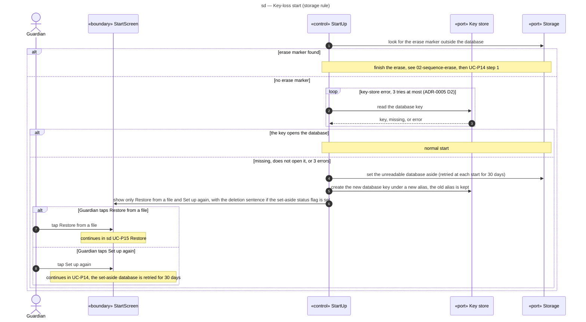

# Sequence diagram — parent-space — key-loss start

> **Feature**: parent-space domain, start-up when the database key is lost (storage rule, UC-P14 *a and *a1, UC-P15)
> **Source specs**: `docs/architecture/specs/use-cases.md` (storage rule, UC-P14, UC-P15)
> **Related ADRs**: ADR-0003 (D1, D3), ADR-0004 (D17), ADR-0005 (D2, D3)
> **Decisions captured**: S1

## Context

Referenced from [03-sequence-restore.md](03-sequence-restore.md). The PIN lives in the encrypted database, so it cannot gate this screen (ADR-0003, OQ-6). An unfinished erase (marker found) is completed before anything else ([02-sequence-erase.md](02-sequence-erase.md)).

Progressive disclosure: only two buttons, "Restore from a file" and "Set up again".

## Diagram

## Notes

- At each later start the set-aside database is retried with the key store; if it opens again within the 30 days, the app offers "Bring back the old data" (UC-P14 *a1: PIN of the old database, its own lockout, one transaction with the UC-P15 rules, replaced data deleted; if no new set-up was completed it simply becomes the database again), otherwise it keeps waiting; after 30 days it is deleted and a SET_ASIDE_DELETED note is raised (ADR-0004 D17). With no new set-up or restore, there is no database for that note: a flag in a set-aside status file (not the erase marker) shows "The old data could not be opened and was deleted." on this screen until the next set-up or restore (ADR-0005 D3).
- The retry waits 1 s then 2 s. A key that reads fine on any of the 3 tries ends the loop and the start goes on normally.
- Key lifecycle: the old alias is kept for the 30-day window and deleted together with the set-aside database; if "Bring back the old data" succeeds, the new alias is deleted instead. The Guardian may give the old credential's recovery code instead of its PIN, then sets a new PIN (same lockout).
- A database that SQLCipher does not protect is refused at start-up (ADR-0003 D1), never opened in clear.
