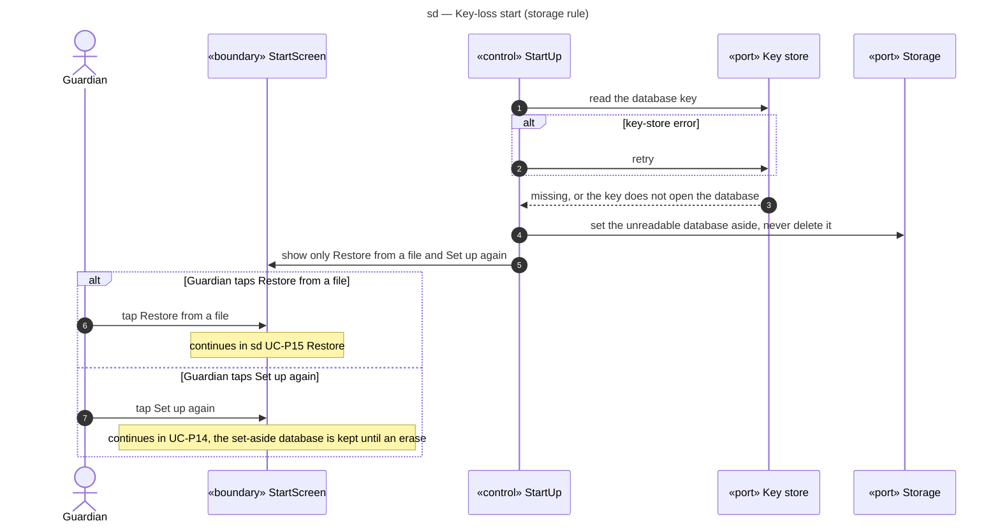

# Sequence diagram — parent-space — key-loss start

> **Feature**: parent-space domain, start-up when the database key is lost (storage rule, UC-P14 *a, UC-P15)
> **Source specs**: `docs/architecture/specs/use-cases.md` (storage rule, UC-P14, UC-P15)
> **Related ADRs**: ADR-0003 (D1, D3)
> **Decisions captured**: S1

## Context

Referenced from [03-sequence-restore.md](03-sequence-restore.md). The PIN lives in the encrypted database, so it cannot gate this screen (ADR-0003, OQ-6). An unfinished erase (marker found) is completed before anything else ([02-sequence-erase.md](02-sequence-erase.md)).

Progressive disclosure: only two buttons, "Restore from a file" and "Set up again".

## Diagram

## Notes

- A database that SQLCipher does not protect is refused at start-up (ADR-0003 D1), never opened in clear.
