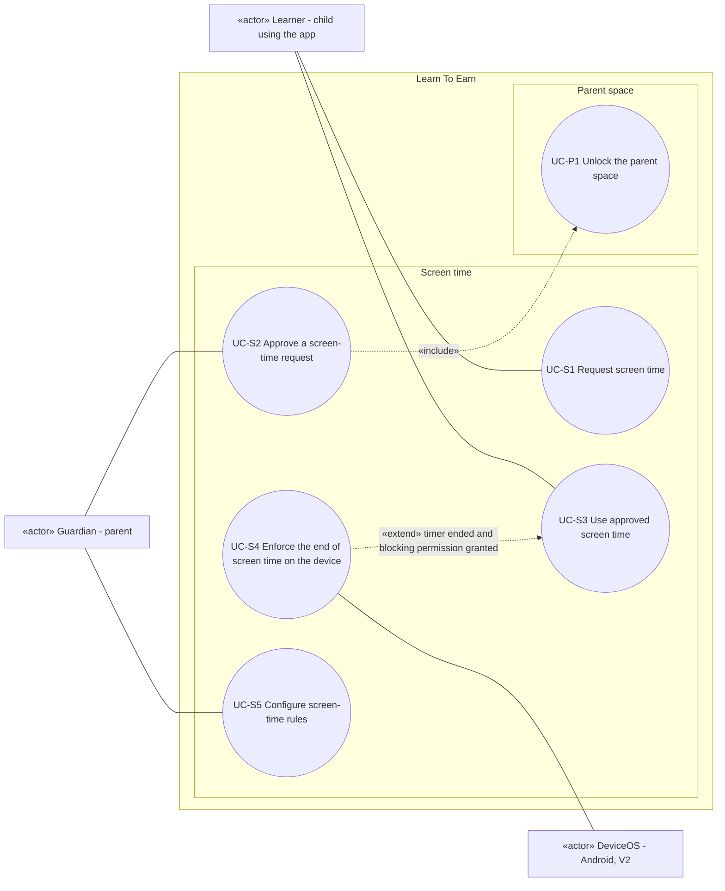

# Use case diagram — screen-time — request, approve, use, enforce

> **Feature**: screen-time domain of Learn To Earn (reward conversion and control)
> **Source specs**: `docs/architecture/specs/use-cases.md` (UC-S1 to UC-S5, UC-P1)
> **Related ADRs**: ADR-0001
> **Decisions captured**: Q1, Q4, Conversion, P0, P1, P3

## Context

Covers how earned minutes become authorised screen time. UC-P1 (parent space) is shown only because UC-S2 includes it. It is defined in the `parent-space` diagram. Does not cover how minutes are earned (see `learning`).

## Diagram

## Notes

- UC-S1 and UC-S2 are linked by data (a pending request), not by a UML relationship: two actors pursue two separate goals.
- UC-S5 has the precondition "parent space unlocked" (ADR-0001 D2), so no include arrow is drawn.
- UC-S4 is an extension with no direct Learner link (actor inherited from UC-S3, the Guardian is the beneficiary). DeviceOS is its secondary actor. It ships in V2. In V1 the timer is declarative.
- The extension point `timer ended` is declared on UC-S3. The 5-minute warning, the alarm and the reserve debit are steps or postconditions of UC-S3, not use cases (ADR-0001 D4).
- Open point: remote approval on the parent's phone (OQ-2).
