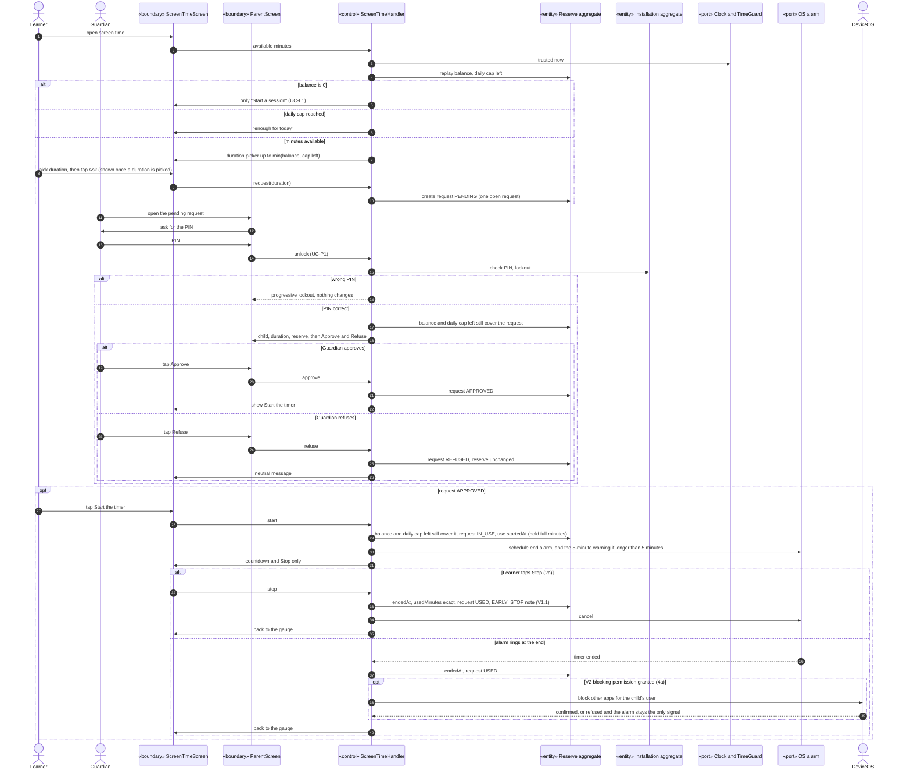

# Sequence diagram — screen-time — request, approval and use

> **Feature**: screen-time domain, UC-S1, UC-S2 (with UC-P1), UC-S3 (with extension 4a in V2)
> **Source specs**: `docs/architecture/specs/use-cases.md` (UC-S1, UC-S2, UC-S3, UC-P1)
> **Related ADRs**: ADR-0001 (D8), ADR-0002 (D2)
> **Decisions captured**: Q1, Q4, P0, P1, P3, Conversion

## Context

The full path from earned minutes to a finished timer. The balance is replayed from the credits, oldest first (ADR-0002 D2). Only one request is open at a time (domain C12).

Progressive disclosure: with a reserve of 0 the child sees only "Start a session". The duration picker appears only when minutes are available, "Ask" only once a duration is picked, "Start the timer" only once the request is approved, "Stop" only while the timer runs.

## Diagram

## Notes

- App killed or device restarted (UC-S3 *a): on return the handler reads `startedAt`, debits `min(minutes, now − startedAt)` and closes a timer whose end has passed. A backwards clock debits the full minutes and raises a CLOCK_CHANGED note (domain C16).
- A request PENDING or APPROVED at the end of its day becomes EXPIRED with no debit.
- The alarm is an OS port scheduled at start, so it rings even if the app is closed.
- DeviceOS appears only in V2 (ADR-0001 D8: former UC-S4).
