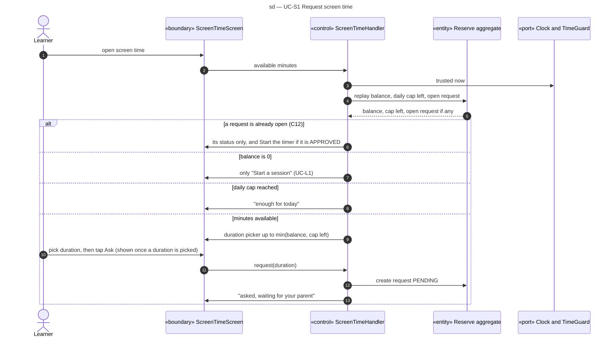

# Sequence diagram — screen-time — request screen time

> **Feature**: screen-time domain, UC-S1
> **Source specs**: `docs/architecture/specs/use-cases.md` (UC-S1)
> **Related ADRs**: ADR-0001 (D8), ADR-0002 (D2)
> **Decisions captured**: Q1, Q4, P0, P1, P3, Conversion

## Context

The balance is replayed from the credits, oldest first (ADR-0002 D2). Only one request is open at a time (domain C12). Approval: [03-sequence-approval.md](03-sequence-approval.md). Use: [04-sequence-use.md](04-sequence-use.md).

Progressive disclosure: while a request is open the child sees only its status. With a reserve of 0 the child sees only "Start a session". The duration picker appears only when minutes are available, "Ask" only once a duration is picked.

## Diagram

## Notes

- A request PENDING or APPROVED at the end of its day becomes EXPIRED with no debit (UC-S2 rule).
