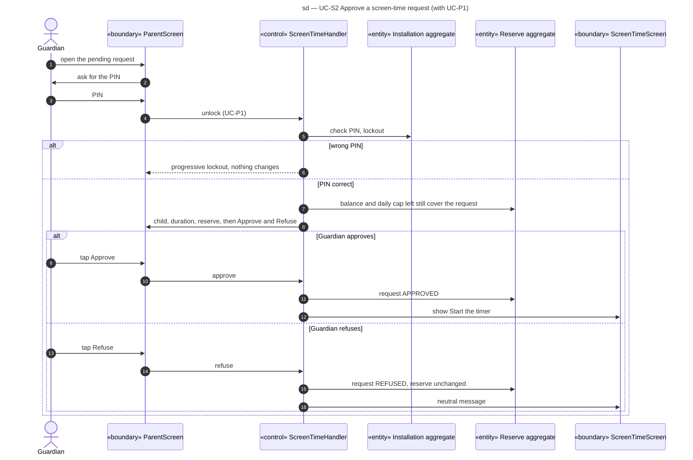

# Sequence diagram — screen-time — approve a request

> **Feature**: screen-time domain, UC-S2 (with UC-P1)
> **Source specs**: `docs/architecture/specs/use-cases.md` (UC-S2, UC-P1)
> **Related ADRs**: ADR-0001 (D8), ADR-0002 (D2)
> **Decisions captured**: Q1, Q4, P0, P1, P3, Conversion

## Context

The Guardian answers on the same tablet. The balance and the daily cap are checked again because they may have changed since the request (C11, C12).

Progressive disclosure: the parent screen shows the PIN pad first, the request details and the Approve and Refuse buttons only after a correct PIN.

## Diagram

## Notes

- Wrong-PIN handling is owned by UC-P1. Remote approval on the parent's phone stays open (OQ-2).
