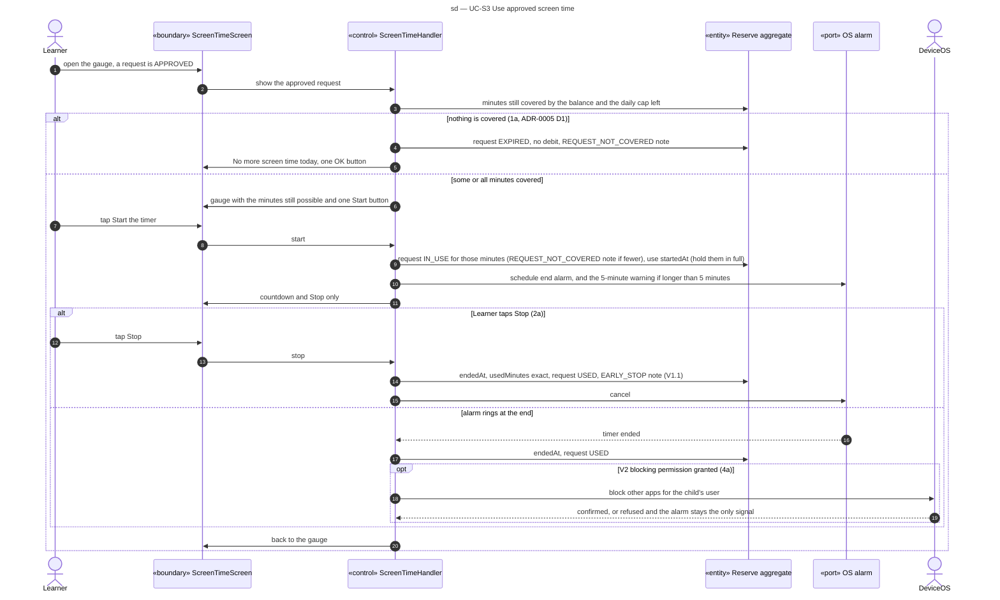

# Sequence diagram — screen-time — use approved time

> **Feature**: screen-time domain, UC-S3 (with extension 4a in V2)
> **Source specs**: `docs/architecture/specs/use-cases.md` (UC-S3)
> **Related ADRs**: ADR-0001 (D8), ADR-0002 (D2), ADR-0005 (D1)
> **Decisions captured**: Q1, Q4, P0, P1, P3, Conversion

## Context

From its start the use holds the full requested minutes (C11). DeviceOS appears only in V2 (ADR-0001 D8: former UC-S4).

Progressive disclosure: "Start the timer" appears only once the request is approved, under the gauge with the minutes still possible (never a question, ADR-0005 D1), then only the countdown and "Stop" are shown.

## Diagram

## Notes

- App killed or device restarted (UC-S3 *a): on return the handler reads `startedAt`, debits `min(minutes, now − startedAt)` and closes a timer whose end has passed. A backwards clock debits the full minutes and raises a CLOCK_CHANGED note (domain C16).
- The alarm is an OS port scheduled at start, so it rings even if the app is closed.
